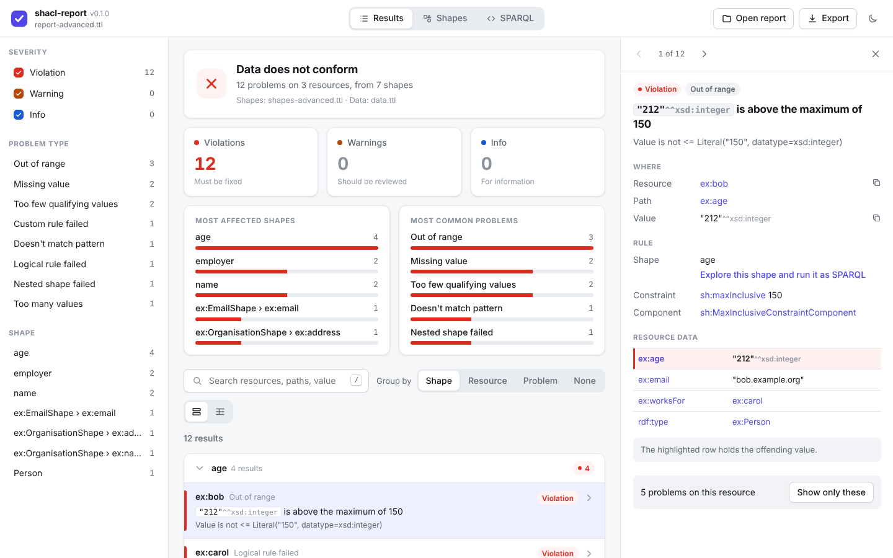
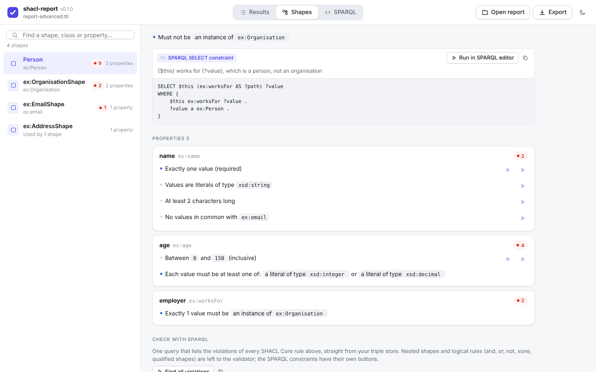
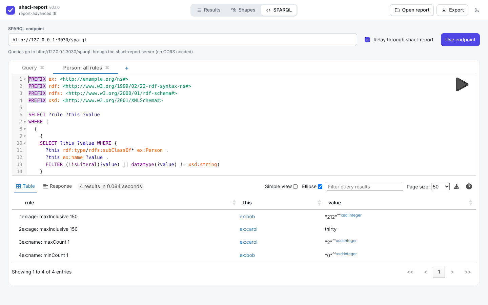
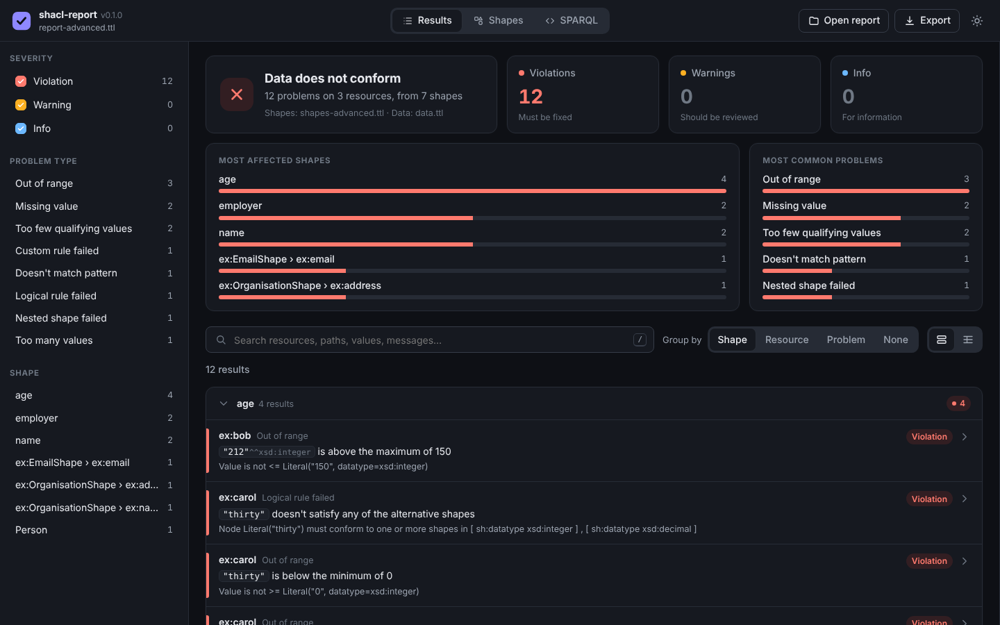

# shacl-report

A small, fast CLI that validates RDF with [SHACL](https://www.w3.org/TR/shacl/)
and turns the validation report into something people can actually read. It
lets you explore the shapes behind it and run them as SPARQL against your
triple store. Validate with the built-in engine (SHACL Core and SHACL-SPARQL,
passing the W3C test suite), or bring the report of **any** other validator
(pyshacl, Apache Jena, TopBraid, rudof, RDF4J, …): it reads the standard
`sh:ValidationReport` vocabulary.

Validators produce reports as raw RDF. On a real data set that is hundreds of
anonymous `sh:ValidationResult` nodes pointing at blank-node property shapes.
`shacl-report` flattens them into a table you can group, filter and search,
names every shape, shows the constraint that was broken, and puts the focus
node's own triples next to each result.

**Live demo:** <https://shacl-report.matdata.eu/>. The demo runs on a modest server, so it may slow down when many people use it at the same time. For heavy or regular use, run it locally or host your own instance (see [Install](#install) and [Running as a public website](#running-as-a-public-website)).







<details><summary>Dark theme</summary>



</details>

## Features

- **Built-in SHACL validation.** Give data and shapes without a report and
  `shacl-report` validates itself: every SHACL Core constraint, `sh:sparql`
  constraints and SPARQL-based constraint components (pre-binding of `$this`,
  `$value`, `$PATH`, `$currentShape`, `$shapesGraph` and parameters). It passes
  all 120 tests of the W3C SHACL core and SPARQL test suites (vendored in
  `tests/w3c`) and gives the same results as pyshacl on the fixtures.
  `--save-report` writes the `sh:ValidationReport` as Turtle; in the viewer it
  is under Export.
- **Validator-agnostic.** Reads any RDF file containing an
  `sh:ValidationReport` (or bare `sh:ValidationResult` nodes).
- **Readable shapes.** Property shapes are shown as `Parent shape › path`,
  using `sh:name` / `rdfs:label` when present. Anonymous property shapes from a
  separate shapes file are matched back by path and constraint (pass `--shapes`).
- **The broken constraint.** With `--shapes`, each result shows the parameter it
  violated, e.g. `sh:maxInclusive 150` or `sh:in ("BE" "NL" "LU")`.
- **Focus-node context.** With `--data`, the details panel lists the focus
  node's triples and highlights the offending value (or says the value is
  missing).
- **Full SHACL property paths**, rendered as SPARQL paths: `^ex:worksFor`,
  `ex:address / ex:country`, `(ex:a | ex:b)*`.
- **Plain-language problems.** Every result is explained in words, e.g.
  *"212" is above the maximum of 150* or *Missing a value for ex:name*, and
  grouped into problem types such as *Missing value* or *Out of range*.
- **Web viewer** (`--view` / `serve`):
  - an overview with conformance status, severity counts and the most affected
    shapes and most common problems (all clickable as filters);
  - results as cards grouped by shape, resource or problem type, or as a
    sortable table;
  - filters for severity, problem type and shape, plus full-text search;
  - a details panel with the rule, the resource's data and keyboard
    navigation (`j`/`k`, `/` to search, `Esc` to close);
  - drag-and-drop loading of the report, shapes and data files;
  - light and dark themes, and a layout that works on a phone;
  - CSV export of the shown results and a standalone HTML download.
- **Shapes explorer** (`--shapes`, with or without a report):
  - every node and property shape with its targets, described in plain
    language (*Every instance of ex:Person*, *Every resource with a value for
    ex:email*), and how many results it produced;
  - every SHACL Core constraint as a readable rule: cardinality (`sh:minCount`,
    `sh:maxCount`), value type (`sh:datatype`, `sh:class`, `sh:nodeKind`),
    ranges and lengths, `sh:pattern`, lists (`sh:in`, `sh:languageIn`),
    `sh:hasValue`, property pairs (`sh:equals`, `sh:disjoint`, `sh:lessThan`),
    nested shapes (`sh:node`), qualified value shapes
    (`sh:qualifiedValueShape` with its min/max counts), logical constraints
    (`sh:and`, `sh:or`, `sh:not`, `sh:xone`) and closed shapes;
  - SPARQL constraints (`sh:sparql`) and custom SPARQL-based constraint
    components (`sh:ConstraintComponent` validators), with their queries;
  - links between shapes and results in both directions.
- **SPARQL editor** ([MatGUI](https://github.com/Matdata-eu/MatGUI), bundled):
  point it at the SPARQL endpoint that holds your data and run, with one click,
  - a generated query that finds the violations of a single rule or of a whole
    shape, scoped to the shape's focus nodes;
  - a SPARQL constraint or custom component validator, with `$PATH`,
    `$currentShape` and parameters substituted, `sh:prefixes` declared and
    `$this` bound to the shape's targets;
  - the focus nodes of a shape.

- **Describe any IRI**, as in MatGUI: Ctrl+click (Cmd+click on a Mac) an IRI
  anywhere in the report, the details panel or the shapes explorer to load its
  triples from the endpoint into a Turtle viewer; Ctrl+Shift+click loads the
  triples that point to it. In the viewer, Ctrl+click any IRI, prefixed name
  (`ex:carol`) or `a` to keep exploring. The viewer is MatGUI's Response view,
  ported with its CodeMirror 6 editor and Turtle grammar, plus prefixed names.

  In the local viewer, queries can be relayed through `shacl-report` so
  endpoints that do not send CORS headers work too.
- **Rule coverage** (`--data` and `--shapes`): which data no rule checks.
  - per class, the resources a shape targets, the resources a shape reaches
    through a nested shape (`sh:node`, `sh:property`, `sh:qualifiedValueShape`,
    logical constraints), and the resources nothing checks;
  - per class and property, the share of values that a constrained property
    shape's path walks (sequence, inverse, alternative and closure paths
    included), broken down by rule category (cardinality, value type, range,
    text, allowed values, comparison, nested shape, logic, SPARQL);
  - rules that match nothing: shapes without focus nodes, and property shapes
    whose path has no values, with a likely typo (`ex:adress` → `ex:address`);
  - a hint when a shape could check a class through an `rdfs:subClassOf`
    triple that is only in the shapes graph;
  - in the viewer, a Coverage tab with a class tree, a class × category
    matrix, and a starter shape for every gap;
  - `--coverage-min` fails a CI run when coverage drops, e.g. when the data
    gains a property nobody wrote a rule for.

  See [Rule coverage](#rule-coverage) for how it is counted.
- **Files or URLs**: the report, shapes and data can be local files or
  `http(s)` URLs (content negotiation picks an RDF format).
- **Self-contained HTML report** (`--html report.html`): the same viewer with
  the data inlined, no server needed. Ideal as a CI artifact.
- **CI mode** (`--ci`) exits non-zero when results at or above `--fail-on`
  severity exist.
- **Multiple input formats** auto-detected from the extension: Turtle (`.ttl`),
  N-Triples (`.nt`), RDF/XML (`.rdf`, `.owl`, `.xml`), TriG (`.trig`),
  N-Quads (`.nq`); transparent gzip for `.gz`.

## Install

From source (requires a stable Rust toolchain):

```sh
cargo install --path .
```

Or, once published:

```sh
cargo install shacl-report
```

Or use the Docker image (see [Docker](#docker)):

```sh
docker pull ghcr.io/matdata-eu/shacl-report:latest
```

## Usage

Validate with the built-in engine:

```sh
# Validate, print a summary and open the results in the browser
shacl-report --data data.ttl --shapes shapes.ttl --view

# Validate in CI, keep the report and fail the build on violations
shacl-report --data data.ttl --shapes shapes.ttl \
    --save-report report.ttl --html shacl-report.html --ci
```

Or read the report of the validator you already use:

```sh
pyshacl -s shapes.ttl -f turtle data.ttl > report.ttl
# or: shacl validate --shapes shapes.ttl --data data.ttl > report.ttl   (Apache Jena)
```

```sh
# Summary on stderr
shacl-report report.ttl

# Explore it in the browser, with shape and data context
shacl-report report.ttl --shapes shapes.ttl --data data.ttl --view

# Explore only the shapes, and run them against your triple store
shacl-report serve --shapes https://example.org/shapes.ttl \
    --endpoint https://example.org/sparql

# Write a standalone HTML report and fail the build on violations
shacl-report report.ttl --shapes shapes.ttl --data data.ttl \
    --html shacl-report.html --ci
```

Summary output:

```
conforms=false  results=11  violations=8  warnings=2  info=1
focus-nodes=3  shapes=7
       4  Person › ex:age
       2  Person › ex:name
       1  ex:OrganisationShape › ex:address / ex:country
       …
```

### Web viewer

```sh
# Empty viewer — drop the files into the browser
shacl-report serve

# Preload a report with its shapes and data, and the SPARQL endpoint of the data
shacl-report serve --report report.ttl --shapes shapes.ttl --data data.ttl \
    --endpoint http://localhost:3030/ds/sparql

# Bind to a fixed port and skip auto-opening the browser
shacl-report serve --report report.ttl --bind 127.0.0.1:8080 --no-open
```

The viewer runs entirely offline — all assets (Tabulator, MatGUI) are bundled
inside the binary. Only the SPARQL editor talks to the endpoint you give it.

#### Shapes and SPARQL

With shapes loaded, the viewer gets a **Shapes** and a **SPARQL** tab. Pick a
shape to see what it applies to and every rule it checks; the ▶ buttons open a
query in the SPARQL tab and run it on your endpoint:

| Button | Query |
| --- | --- |
| ▶ next to a rule | Focus nodes or values that break that one rule. |
| *Find all violations* | Every SHACL Core rule of the shape and its property shapes in one `UNION`, with a `?rule` column. |
| *Run in SPARQL editor* on a SPARQL constraint | The constraint's own query, ready to run outside a validator. |
| *List focus nodes* | The resources the shape's targets select. |

Generated queries cover the constraints that plain SPARQL can express
(cardinality, datatype, class, node kind, ranges, lengths, pattern, `sh:in`,
`sh:languageIn`, `sh:hasValue`, `sh:uniqueLang`, property pairs and closed
shapes). Nested and logical constraints are described but left to your
validator. Shapes used only through `sh:node` get their focus nodes from the
shape that refers to them. The endpoint is remembered in the browser; in the
local viewer the *Relay through shacl-report* option sends queries via the
`/api/sparql` relay, which also forwards an `Authorization` header. In a
standalone HTML report the browser talks to the endpoint directly, so the
endpoint must allow CORS.

### In CI

```yaml
- run: pyshacl -s shapes.ttl -f turtle data.ttl > report.ttl || true
- run: shacl-report report.ttl --shapes shapes.ttl --data data.ttl --html shacl-report.html --ci
- uses: actions/upload-artifact@v4
  if: always()
  with:
    name: shacl-report
    path: shacl-report.html
```

To fail the build when a new property or class has no rule:

```yaml
- run: shacl-report --shapes shapes.ttl --data data.ttl --coverage --coverage-min 100 --coverage-report coverage.json
```

### Docker

The image `ghcr.io/matdata-eu/shacl-report` holds only the binary
(distroless, running as an unprivileged user). `latest` and version tags
such as `0.2.0` come from releases, for amd64 and arm64. `edge` follows the
`main` branch (amd64 only).

**Run the web app as a public website.** By default the image starts the
viewer in [public mode](#running-as-a-public-website) on port 8080:

```sh
docker run -d --name shacl-report -p 8080:8080 --memory 4g --restart unless-stopped \
  ghcr.io/matdata-eu/shacl-report:latest
```

**Use the CLI on your own files.** Mount the folder holding them at `/data`
and pass the usual arguments:

```sh
docker run --rm -v "$PWD:/data" ghcr.io/matdata-eu/shacl-report \
  --data data.ttl --shapes shapes.ttl --html report.html --ci
```

**Use the viewer locally**, with your files preloaded and without the public
limits:

```sh
docker run --rm -p 8080:8080 -v "$PWD:/data" -e SHACL_REPORT_PUBLIC=false \
  ghcr.io/matdata-eu/shacl-report serve --no-open --data data.ttl --shapes shapes.ttl
```

With Docker Compose, behind a reverse proxy that terminates HTTPS:

```yaml
services:
  shacl-report:
    image: ghcr.io/matdata-eu/shacl-report:latest
    restart: unless-stopped
    ports: ["127.0.0.1:8080:8080"]   # only the proxy can reach it
    mem_limit: 4g
    environment:
      SHACL_REPORT_TRUST_PROXY: "true"
      SHACL_REPORT_MAX_SESSIONS: "10"
      SHACL_REPORT_ENDPOINT: "https://example.org/sparql"
```

Build the image yourself with `docker build -t shacl-report .`.

### Running as a public website

`serve --public` (the default in the Docker image) makes the viewer safe to
put on the internet. Without it the viewer is a single-user tool: everyone
who opens it sees the same report, and it reads files and fetches URLs on the
server's behalf. In public mode:

- **Every visitor gets their own session.** Files a visitor uploads are only
  visible to them, through an unguessable `HttpOnly` session cookie. A
  report preloaded at startup (`--report`, `--shapes`, `--data`) is shown to
  visitors until they load their own, which is handy for a demo.
- **Only active users hold a slot.** A session starts when a visitor loads
  files, not when they open the page, so crawlers and health checks cost
  nothing. At most `--max-sessions` sessions exist at once, and at most
  `--max-sessions-per-ip` per address, so one visitor cannot take every
  slot. When the server is full, new visitors are told to try again in a few
  minutes (HTTP 503 with `Retry-After`).
- **Idle sessions end on their own.** A session ends `--session-idle-minutes`
  after its last request and frees its slot. An open tab keeps its session
  alive while it is in view, and a hidden or closed tab lets it expire.
  Loading new files reuses the visitor's own slot.
- **Heavy work is queued.** At most `--max-jobs` uploads are parsed and
  validated at the same time, and each session runs one at a time. Others
  wait in line for up to `--queue-seconds`, then are told the server is busy.
  A validation stops after `--job-seconds`.
- **Uploads are bounded.** An upload may be at most `--max-upload-mb`, each
  file may grow to at most that size once decompressed (so a small `.gz`
  cannot unpack into gigabytes), and it may hold at most `--max-triples`.
- **The server only reaches what you allow.** It reads no server paths and
  fetches no URLs for visitors; they upload files instead. The SPARQL relay
  only forwards to `--endpoint` and `--allow-endpoint`, so it cannot be
  used to reach your internal network. Visitors can still query any endpoint
  that allows CORS straight from their browser.

**Sizing.** Memory is what limits a public server. As a rough guide, 100,000
triples with 20,000 violations take about 400 MB while being validated, and
the loaded result stays in memory for the session. Plan for
`--max-sessions` × the memory of a typical upload, plus `--max-jobs` × the
memory of the largest allowed upload. The defaults (10 sessions, 2 jobs,
100,000 triples) fit in about 4 GB. Set a memory limit on the container so a
miscalculation restarts the server instead of the host.

**Behind a reverse proxy**, set `--trust-proxy` so the per-IP limit uses the
visitor's address from the last `X-Forwarded-For` entry. Only set it when a
proxy you control sets that header, because otherwise visitors can choose
their own address. Let the proxy handle HTTPS, and allow request bodies a
third larger than `--max-upload-mb` (uploads are base64-encoded). `/healthz`
answers `ok` for load balancers.

### Options — report (default)

| Flag | Description |
| --- | --- |
| `--data <FILE>` | Data graph; shows focus-node triples. Without a report, it is validated against `--shapes`. Repeatable. |
| `--shapes <FILE>` | Shapes graph that was used; shows shape names and constraints, and enables the shapes explorer. Without a report, `--shapes` alone summarises the shapes graph. Repeatable. |
| `--format <FMT>` | Force the report's input format (`nt`, `ttl`, `rdf`/`xml`, `trig`, `nq`). |
| `--prefixes <FILE>` | Extra prefixes for shortening IRIs, from SHACL declarations or `@prefix` lines (see [Prefixes](#prefixes)). Repeatable. |
| `--save-report <FILE>` | Write the report of the built-in validator as Turtle. |
| `--html <FILE>` | Write a self-contained HTML report. |
| `--ci` | Exit with code 1 when results at or above `--fail-on` exist. |
| `--fail-on <SEV>` | `violation` (default), `warning` or `info`. |
| `--endpoint <URL>` | SPARQL endpoint holding the data, preset in the viewer's SPARQL tab. |
| `--coverage` | Print the rule coverage per class and property, and the rules that match nothing. |
| `--coverage-report <FILE>` | Write the coverage as JSON, or as CSV (one row per class and property) for a `.csv` file. |
| `--coverage-min <PCT>` | Exit with code 1 when less than PCT % of the property values are checked. |
| `--coverage-min-resources <PCT>` | Exit with code 1 when less than PCT % of the resources are covered. |
| `--coverage-ignore <IRI>` | Leave a class or predicate out of the coverage (full IRI, `<iri>` or prefixed name). Repeatable. |
| `--coverage-ignore-annotations` | Leave labels, comments and other annotation properties out of the coverage. |
| `--quiet` | Suppress the summary on stderr. |
| `--view` | Open the report in the local web viewer. |
| `--no-open` | Do not auto-open the system browser (implies `--view`). |
| `--bind <ADDR>` | Bind address for the viewer (default: `127.0.0.1:0`). |

### Options — `serve` subcommand

| Flag | Description |
| --- | --- |
| `--report <FILE>` | Report to preload. |
| `--data <FILE>` | Data graph to preload; validated against `--shapes` when no report is given. Repeatable. |
| `--shapes <FILE>` | Shapes graph to preload; enough on its own to explore shapes. Repeatable. |
| `--endpoint <URL>` | SPARQL endpoint holding the data, preset in the SPARQL tab. |
| `--format <FMT>` | Force the report's input format. |
| `--prefixes <FILE>` | Extra prefixes for shortening IRIs. Repeatable. |
| `--bind <ADDR>` | Bind address (default: `127.0.0.1:0`). |
| `--no-open` | Do not auto-open the system browser. |

Public server options (see [Running as a public website](#running-as-a-public-website)).
Each flag can also be set with the environment variable in brackets.

| Flag | Default | Description |
| --- | --- | --- |
| `--public` (`SHACL_REPORT_PUBLIC`) | off | Per-visitor sessions, no server-side paths or URLs, relay allow-list, and the limits below. |
| `--max-sessions` (`SHACL_REPORT_MAX_SESSIONS`) | 10 | Visitors with files loaded at the same time. |
| `--max-sessions-per-ip` (`SHACL_REPORT_MAX_SESSIONS_PER_IP`) | 2 | Sessions one IP address can hold. |
| `--session-idle-minutes` (`SHACL_REPORT_SESSION_IDLE_MINUTES`) | 30 | Inactivity after which a session and its files are dropped. |
| `--max-jobs` (`SHACL_REPORT_MAX_JOBS`) | 2 | Uploads parsed or validated in parallel. |
| `--queue-seconds` (`SHACL_REPORT_QUEUE_SECONDS`) | 30 | How long an upload waits for a free job before the server reports it is busy. |
| `--job-seconds` (`SHACL_REPORT_JOB_SECONDS`) | 120 | Longest one validation may run. |
| `--max-upload-mb` (`SHACL_REPORT_MAX_UPLOAD_MB`) | 20 | Largest upload, and largest size of any file once decompressed. |
| `--max-triples` (`SHACL_REPORT_MAX_TRIPLES`) | 100000 | Most triples in one upload. |
| `--allow-endpoint <URL>` (`SHACL_REPORT_ALLOW_ENDPOINTS`, comma-separated) | none | Endpoints the SPARQL relay may reach, besides `--endpoint`. Repeatable. |
| `--trust-proxy` (`SHACL_REPORT_TRUST_PROXY`) | off | Take the visitor's IP from the last `X-Forwarded-For` entry. |

`--bind` (`SHACL_REPORT_BIND`) and `--endpoint` (`SHACL_REPORT_ENDPOINT`)
can also be set through the environment.

### Exit codes

| Code | Meaning |
| --- | --- |
| `0` | Success (or, without `--ci`, completed even if results exist). |
| `1` | `--ci` was set and results at or above `--fail-on` were found, or coverage is below `--coverage-min` / `--coverage-min-resources`. |
| `2` | Error (I/O, parse, no report found, etc.). |

### Prefixes

IRIs are shortened with prefixes from four sources, in this order (the first
source to claim a prefix name wins):

1. Files given with `--prefixes`. They can declare prefixes the SHACL way,
   which is handy for a shared prefix file kept next to your shapes:

   ```turtle
   @prefix sh:  <http://www.w3.org/ns/shacl#> .
   @prefix xsd: <http://www.w3.org/2001/XMLSchema#> .

   <http://example.org/prefixes> sh:declare
       [ sh:prefix "era" ; sh:namespace "http://data.europa.eu/949/"^^xsd:anyURI ] .
   ```

   Their `@prefix` lines count too.
2. The `@prefix` lines of the report, shapes and data files.
3. `sh:declare` declarations in the shapes, report and data. In the viewer,
   drop a prefix file in with the shapes to use it.
4. Well-known prefixes from [prefix.cc](https://prefix.cc), for namespaces that
   occur in your files but that nothing above declares.

The prefix.cc list is fetched when shacl-report is built, as MatGUI does,
and embedded in the binary. When prefix.cc cannot be reached, the build
quietly uses the copy in `assets/prefixes.json`. Set `SHACL_REPORT_OFFLINE=1`
to skip the download. Cargo does not let a build change the source tree, so
refresh the committed copy now and then with
`curl -fsSL https://prefix.cc/popular/all.file.json -o assets/prefixes.json`.

## Rule coverage

Coverage needs the data and the shapes. It follows SHACL strictly: it uses
the same targets as validation, so subclasses count only through
`rdfs:subClassOf` triples in the data graph. To include inferred types,
give the inferred data.

- **Resources** are grouped by their asserted `rdf:type`. A resource with
  several types counts in every class. Untyped blank nodes are grouped by the
  property and class that point to them (*ex:Person › ex:address*), and the
  remaining untyped resources under *(no type)*.
- **A resource is covered** when a shape targets it, or when a shape is applied
  to it as a value of another shape (`sh:node`, `sh:property` on a property
  shape, `sh:qualifiedValueShape`, `sh:and`/`sh:or`/`sh:xone`/`sh:not`).
  Deactivated shapes do not count.
- **A triple is covered** when the path of a property shape with at least one
  constraint walks it: the intermediate steps of a sequence path and the
  triples behind an inverse path count too. A property shape with no
  constraints (only `sh:name`, say) checks nothing and covers nothing.
  `sh:closed` covers the resource, not its triples. For `sh:sparql`
  constraints on a node shape, the predicates in `$this <predicate>` patterns
  of the query count as covered.
- **Left out**: `rdf:type` triples (unless a path uses `rdf:type`), RDF list
  cells, the ontology and any shapes in the data (OWL, RDFS and SHACL
  resources), triples that are also in the shapes graph, and what
  `--coverage-ignore` names. `--coverage-ignore-annotations` (or the switch in
  the viewer) also leaves out labels and comments.
- **Not evaluated**: SPARQL-based targets (`sh:target`), reported under rules
  that match nothing.

[`examples/coverage`](examples/coverage) has four demo sets, from a fully
covered webshop to an organisation chart that uses every kind of path.

## How it works

1. The report, shapes and data files are each parsed into an in-memory graph
   (quad formats are flattened). Without a report, the built-in engine
   (`src/validate`) validates the data against the shapes and produces the
   report graph; SPARQL runs on Oxigraph's evaluator (`spareval`).
2. Results are collected from `sh:result` on every `sh:ValidationReport`
   (falling back to un-nested `sh:ValidationResult` nodes) and flattened:
   severity, focus node, path, value, messages, source shape and component.
3. Each source shape is resolved against the shapes graph. Named shapes resolve
   directly. Blank-node property shapes cannot, because blank-node labels are
   local to a file, so they are matched on their rendered `sh:path` and the
   constraint parameter of the result's component (`sh:MinCountConstraintComponent`
   → `sh:minCount`). Ties are broken by the parent shape's `sh:targetClass` /
   `sh:targetNode` against the focus node in the data graph.
4. For every IRI focus node, up to 200 of its triples are taken from the data
   graph. Blank-node focus nodes have no context for the same reason as above.
5. The shapes graph is turned into an explorable model: every node and
   property shape (named, blank, or nested in `sh:node`, `sh:or`,
   `sh:qualifiedValueShape`, …), its targets, constraint parameters, SPARQL
   constraints and custom components. Results link to it by the resolved shape.
6. The model is served as JSON to the viewer, or inlined into the HTML export.

## Limitations

- The built-in validator covers SHACL Core and SHACL-SPARQL, not SHACL
  Advanced Features (rules, SPARQL targets, functions) or `owl:imports`.
  Results of nested shapes (`sh:node`, `sh:or`, …) are not added as
  `sh:detail`.
- The SPARQL generated from shapes for the SPARQL tab is a way to explore the
  data in your triple store, not a conforming SHACL engine: nested and logical
  constraints are not translated, and comparisons follow your endpoint's
  SPARQL semantics.
- Nested `sh:detail` results are counted but not yet shown individually.
- Blank-node property shapes that share a path and constraint with another
  shape can only be told apart when `--data` is given.

## Development

```sh
cargo test
cargo clippy --all-targets -- -D warnings
cargo fmt
```

Test fixtures in `tests/fixtures/` were produced with pyshacl from
`shapes.ttl` / `shapes-advanced.ttl` and `data.ttl`.

`THIRD_PARTY_NOTICES.md` lists the licenses of everything compiled into the
binary. After changing dependencies or vendored assets, regenerate it with
[cargo-about](https://github.com/EmbarkStudios/cargo-about) (`cargo install
cargo-about --features cli`):

```sh
cargo about generate about.hbs -o THIRD_PARTY_NOTICES.md
```

## Questions, bugs and feature requests

Please open an issue on GitHub:
<https://github.com/Matdata-eu/shacl-report/issues>.

## Credits

shacl-report is written by Mathias Vanden Auweele ([Matdata](https://matdata.eu/)).

It is built on these open source projects:

- [Oxigraph](https://github.com/oxigraph/oxigraph)'s `oxrdf`, `oxttl`,
  `oxrdfxml`, `spargebra` and `spareval` crates for RDF parsing and SPARQL
  evaluation (MIT / Apache-2.0)
- [axum](https://github.com/tokio-rs/axum) and [Tokio](https://tokio.rs) for
  the web viewer's server (MIT), [ureq](https://github.com/algesten/ureq) with
  [rustls](https://github.com/rustls/rustls) for loading files from URLs
- [clap](https://github.com/clap-rs/clap) for the command line (MIT / Apache-2.0)
- [MatGUI](https://github.com/Matdata-eu/MatGUI), Matdata's fork of
  [YASGUI](https://github.com/zazuko/Yasgui), for the SPARQL tab (MIT)
- [Tabulator](https://tabulator.info) for the results table (MIT)
- [CodeMirror 6](https://codemirror.net/) with
  [codemirror-lang-turtle](https://github.com/aatauil/codemirror-lang-turtle)
  for the Turtle viewer (MIT)
- The popular prefixes of [prefix.cc](https://prefix.cc) in
  `assets/prefixes.json`, for shortening IRIs
- The [W3C SHACL test suite](https://w3c.github.io/data-shapes/data-shapes-test-suite/)
  in `tests/w3c`, under the W3C Software and Document License
  (`tests/w3c/LICENSE.md`)

The full list, with license texts, is in
[THIRD_PARTY_NOTICES.md](THIRD_PARTY_NOTICES.md). The web viewer shows it at
`/licenses` and links to it from its About dialog.

## License

Licensed under the [Apache License 2.0](LICENSE).
